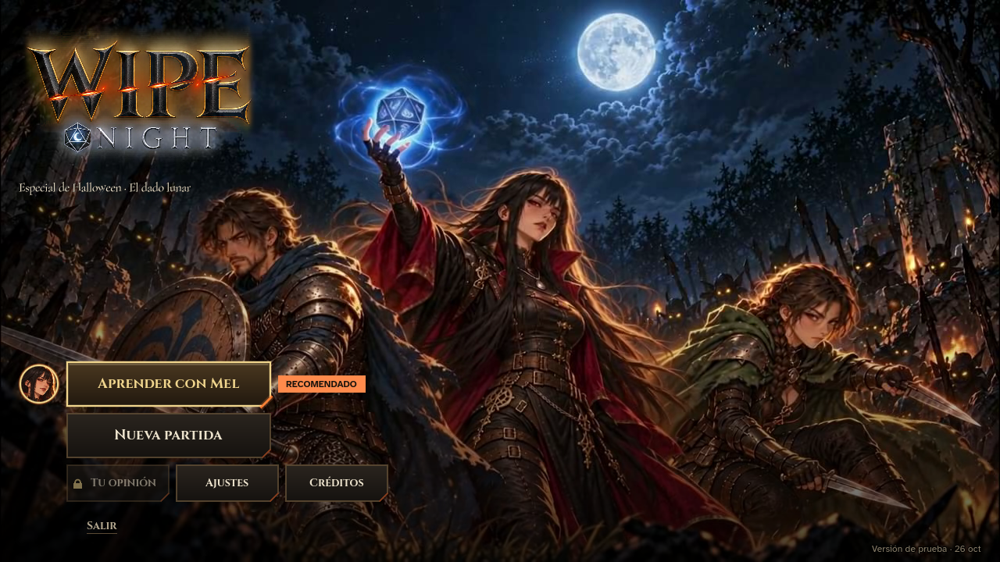
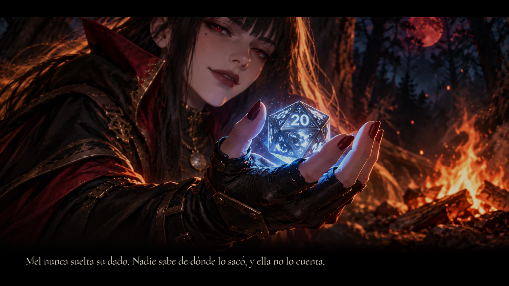
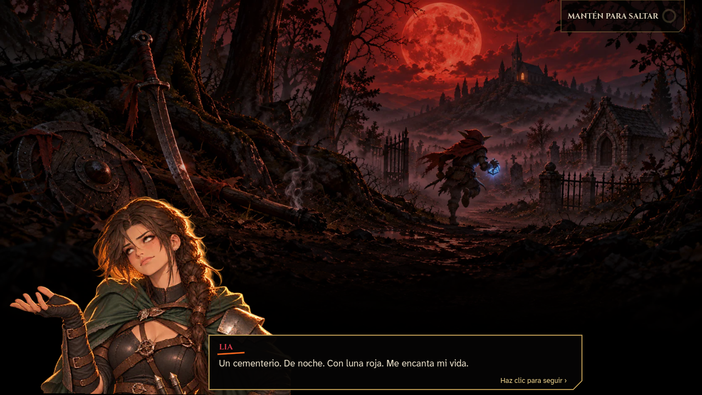
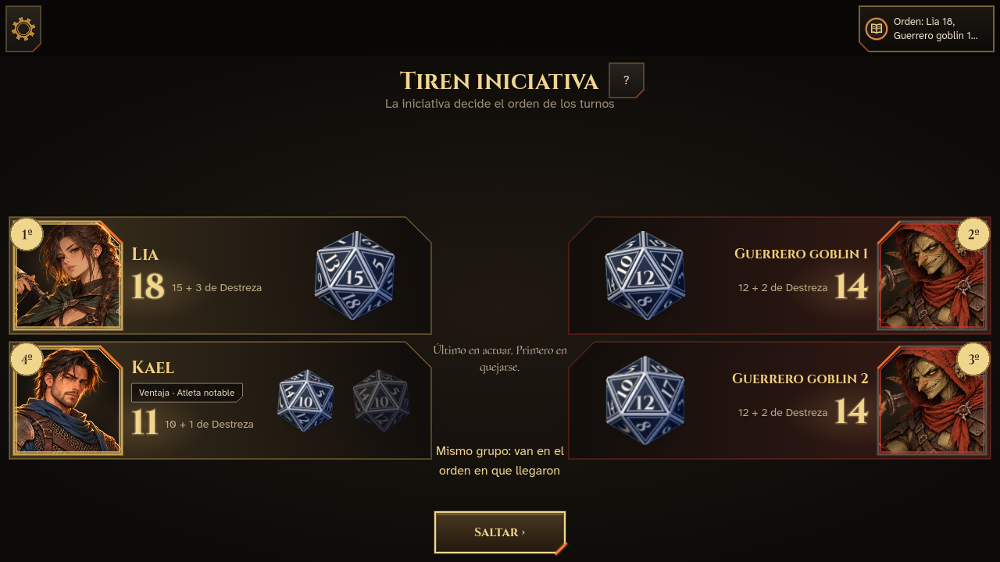
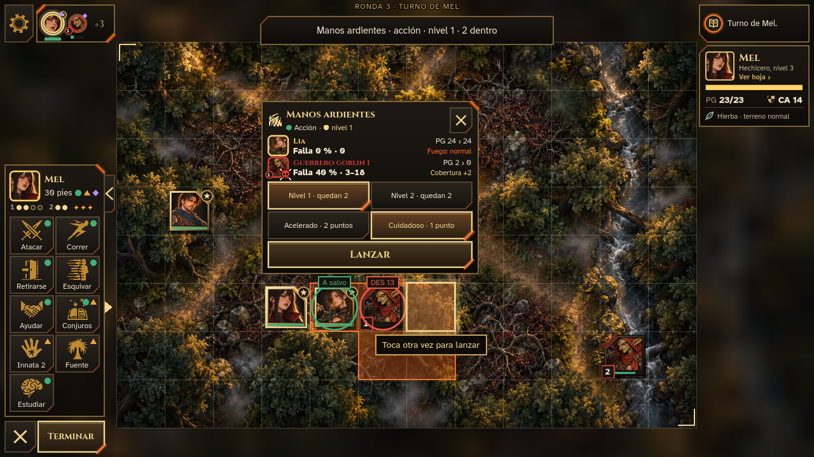
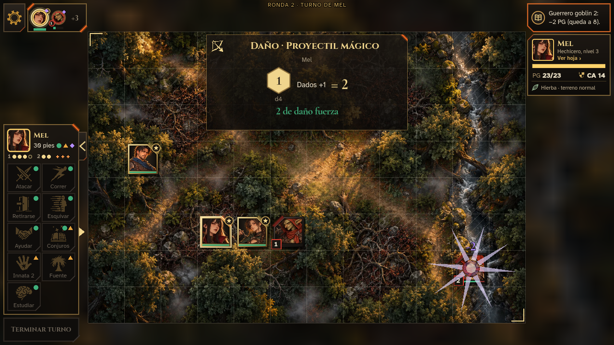
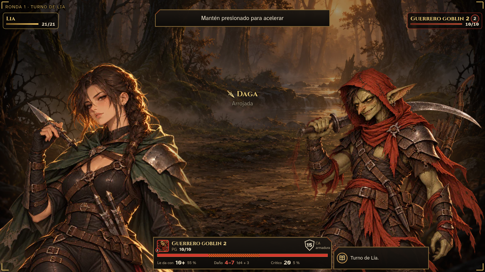

<h1 align="center">Wipe Night</h1>

<b>Rol táctico por turnos compatible con la quinta edición (SRD 5.2.1), hecho en Godot 4.</b> 
<i>Turn-based tactical RPG, 5E-compatible, built in Godot 4.</i>

  
  
  
  

🌐 <a href="https://wipenight.com">wipenight.com</a>

---

> *Luna de sangre. Unos goblins roban el dado de Mel. Su rastro lleva a una capilla donde algo ya espera.*

**Wipe Night** es un juego de rol táctico por turnos con las reglas abiertas de la quinta edición (SRD 5.2.1). Se juega en el navegador, en la computadora o en el celular, sin instalar nada. La primera campaña, **El dado lunar**, es un especial de Halloween.

> **EN** — A turn-based tactical RPG using the open fifth-edition rules (SRD 5.2.1). Playable in the browser on desktop and mobile. You lead Kael, Lia and Mel through a forest, a graveyard and a ruined chapel, rolling a physical-feeling d20 with your finger.

## Qué vas a hacer

- Llevar a un grupo de tres: **Kael**, el guerrero; **Lia**, la pícara, y **Mel**, la hechicera a la que le robaron el dado.
- Agarrar el **d20 en 3D**, agitarlo y lanzarlo con el dedo o el mouse.
- Moverte por mapas con cuadrícula, cobertura y terreno, y usar conjuros como *Manos ardientes* o *Proyectil mágico*.
- Subir del nivel 1 al 3 entre combate y combate.
- **¿Nunca jugaste rol?** Mel te enseña en un tutorial corto, y cada término de reglas se explica con un toque.

## Capturas

| | |
|---|---|
|  |  |
|  |  |
|  |  |

## Hecho con

- **Godot 4.7** y **GDScript**, con exportación web para PC y móvil.
- Reglas de combate del SRD 5.2.1: iniciativa, ventaja, cobertura, tiradas de salvación y conjuros.
- Pruebas automatizadas del motor de reglas y de la interfaz.
- Dados en 3D y la voz de Mel generados por código.

## Estado

En desarrollo. Este repositorio es una **vitrina**: el código fuente es privado. La demo pública llegará pronto a itch.io.

---

This work includes material from the System Reference Document 5.2.1 ("SRD 5.2.1") by Wizards of the Coast LLC, available at https://www.dndbeyond.com/srd. The SRD 5.2.1 is licensed under the Creative Commons Attribution 4.0 International License, available at https://creativecommons.org/licenses/by/4.0/legalcode. 
Iconos de <a href="https://game-icons.net">game-icons.net</a> (Lorc, Delapouite, Zeromancer) bajo CC BY 3.0. Fuentes Cormorant Garamond, Atkinson Hyperlegible Next y Cinzel bajo SIL OFL 1.1. 
Capturas y arte de Wipe Night: todos los derechos reservados.

